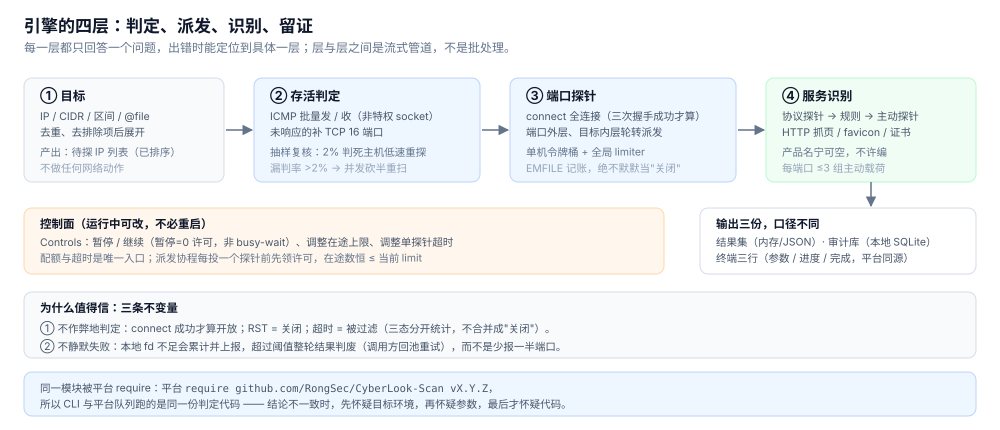

# CyberLook-Scan

自研端口扫描 + 全量指纹识别引擎。connect 扫描 · FingerprintHub 15,388 条规则 · 纯 Go 标准库 · GPL-3.0。

<p>
  
  
  
</p>

---

## 0. 这是什么，以及不是什么

这是**扫描内核**，不是平台。它只负责一件事：给定一批 IP 与一批端口，回答「哪些端口是开的、上面跑的是什么」，
并把判定过程与证据留下来。它不存资产台账、不做调度、不认领责任部门 —— 那些是
[CyberLook](https://github.com/RongSec/CyberLook) 平台的事。

两者共用同一份代码：平台 `require` 本模块的 tag，CLI 直接编译本模块。
所以判断某个结果是"目标的问题"还是"平台的问题"，用 CLI 对着同一目标再跑一次即可。



设计上有一个总原则：**宁可说不知道，也不给一个看起来确定的错答案。**
下面每一节的取舍都从这条原则推出来。

---

## 1. 三个判定原则

### 1.1 端口是三态，不是两态

| 结果 | 含义 | 记到哪 |
|---|---|---|
| `open` | 三次握手成功 | 结果集 |
| `closed` | 目标回了 RST（明确拒绝） | 统计 `closed` |
| `filtered` | 超时 / 静默丢弃（**不知道**） | 统计 `filtered`，单独计数 |

把 `filtered` 并入 `closed` 是最常见的"看起来没问题"的错误：
防火墙静默丢包时，明明开着的端口会被记成关闭，而且事后无法从结果反推。
所以引擎把三态分开统计，`filtered` 数量异常升高本身就是"该调超时或降并发"的信号。

### 1.2 用 connect，不用半开 SYN

半开扫描（SYN + RST）快，但它依赖原始套接字：Windows 需要管理员权限、
中间设备改写响应时无法判断、丢包时只能靠超时猜。connect 全连接虽然多一次握手，
但**成功就是成功**，不需要推断。速度问题用并发解决，不用牺牲确定性解决。

### 1.3 不静默失败

本地 fd 不够（`EMFILE`）时，探针根本发不出去。若不处理，就会变成"这一轮少报了一半端口"，
而调用方完全看不出来。引擎的做法是：累计 `LocalResErrs` 并上报；
超过整轮判废阈值就让这一轮返回 `ErrLocalResourceExhausted`，由调用方把整个单元回池重试。

---

## 2. 存活探测：两阶段 + 抽样复核

`DiscoverHosts` 是所有入口（CLI `-alive`、平台队列）共用的实现：

```
阶段 1  ICMP Echo   非特权 udp4 socket 批量发/批量收，按源 IP 归集
         ├─ Echo Reply            → 存活
         └─ Destination Unreachable → 明确判死，跳过 TCP 阶段
阶段 2  TCP connect  对没回 ICMP 的主机，并发探 16 个常用端口
         ├─ 连上（SYN-ACK）→ 存活
         └─ RST            → 存活（主机回了包，只是端口关着）
阶段 3  抽样复核     从"判死"里抽 2%（64~400 台），以 1/8 速率重探
         └─ 漏判率 > 2% → 并发砍半，重扫判死主机（最多 2 轮）
```

为什么两层都要：实测某 /16 的 605 台存活主机里，312 台常用端口全不通（纯 TCP 会全漏），
310 台不响应 ICMP（纯 ICMP 会全漏）。分层互补，缺一不可。

为什么要有抽样复核：一张网里"没回应"有两种原因 —— 主机真死了，或者**我们的 SYN 被目标的限速/IPS 丢了**。
后者会把活主机判死，而且从结果里看不出来。复核是唯一能在"自己把目标打限速了"时自证的办法。
`AliveStats.SampledN / SampledAlive / Passes / ConcUsed` 就是这次复核的证据。

进度口径：ICMP 与 TCP 各占一半（`(icmpDone + tcpDone) / 2`），两遍都处理全部主机，
所以进度条从 0 单调走到 n，不会先到 100% 再跳回来。

---

## 3. 端口派发与配速

### 3.1 端口外层、目标内层

派发顺序是「先遍历端口，再遍历主机」，同一个批次里每台主机都会先收到第 1 个端口，
再收到第 2 个 —— 效果是：

- 结果出得快：不必等某台主机的 65535 个端口全部探完才看到别的机器；
- 单机压力被摊薄：不会出现"一瞬间对同一台机器打满并发"。

单目标扫描时这条不起作用（只有一个目标），由 3.2 的令牌桶兜底。

### 3.2 单机令牌桶

防火墙对**同一目的 IP** 的新建连接普遍有每秒上限（常见 100~1000 pps），超了就是静默丢包。
`PerHostPPS`（默认 300）给每台主机一个独立令牌桶：300 pps 下扫完 65535 个端口约 3.5 分钟，
既不会触发丢弃，也不会慢到不可用。多目标时由派发轮转自然摊薄，桶不会成为瓶颈。

### 3.3 运行中可改：Controls

`Controls` 是唯一的调控入口，不必重启进程：

| 动作 | 语义 |
|---|---|
| 暂停 | 许可数置 0，派发协程阻塞在条件变量上（不是 busy-wait） |
| 恢复 | 归还许可，继续派发 |
| 调在途上限 | 调高立即生效（下一个探针就用到），调低自然收敛（已有探针跑完才降） |
| 调超时 | 后续探针使用新超时 |

派发协程**每投一个探针前先领许可**，因此"在途探针数 ≤ 当前 limit"是硬不变量，
平台侧的暂停/调速能在 1~2 秒内投影到正在跑的扫描上。

---

## 4. 识别管线

对每个开放端口，按顺序尝试，拿到就停：

```
① 协议探针        被动为主：banner / 握手 → SSH、SMB、MySQL、Redis、RDP、LDAP…
② Windows 握手    445/139/3389/135 及动态 RPC 端口，取真实 OS 与主机名
③ HTTP 抓页       GET 首页 + favicon；容忍 3xx/4xx/自签证书；记录标题、状态码、正文长度
④ 规则匹配        web 3,450 条（word/regex/favicon）+ service 11,938 条，Aho-Corasick 一次过
⑤ 主动探针        按端口发对应载荷，每端口 ≤3 组
⑥ 端口兜底        以上全空但有协议线索时，用协议名占位
```

几处刻意的克制：

- **单一弱词命中不产品化**：`score < 15` 的命中不并入技术栈，否则一个页面能报出四个产品；
- **技术栈最多并列 3 个**，顺序即置信度；
- **重定向手动跟随**：上一跳的响应也是证据（`Server` 头常在 302 上）；
- **TLS 证书 CN/O 参与识别**：内网自签证书经常直接写单位名/系统名，信噪比很高。

识别层任何异常都被 `safeIdentify` 兜底为裸 `tcp` 结果 —— 识别失败不能拖垮扫描。

---

## 5. 输出契约

同一个任务在 CLI 与平台里的终端文案必须一致，否则对照排查要额外翻译一遍。
三行文案由 `portscan/report.go` 统一生成：

```text
[扫描] 参数：并发 600，超时 1000ms，识别=开启（识别并发 32，全量指纹 开启）；本次 1 目标 × 65535 端口 = 65535 探针
[扫描] 进行中 45%（30000/65535 探针，已用 12s，剩余 14s）｜2458 探针/秒｜开放 6 个，识别 6 个
[扫描] 完成 65535/65535 探针，耗时 26s，平均 2520 探针/秒，开放 6 个，识别 6 个
```

JSON 输出（`-out`）：

```jsonc
{
  "targets": 254, "ports": 100, "probes": 25400,
  "open": 42, "closed": 24980, "filtered": 378, "errors": 0,
  "elapsedSec": 3.21, "pps": 7912.5,
  "aliveHosts": [{ "ip": "10.24.20.7", "openPorts": [22, 445] }],
  "aliveCount": 12,
  "openPorts": ["10.24.20.7:22"],
  "services": [{ "ip": "10.24.20.7", "port": 80, "protocol": "http",
                 "product": "nginx", "version": "1.20.1", "source": "probe", "score": 20 }],
  "protoStat": { "http": 30 }, "productTop": { "nginx": 8 }
}
```

`open / closed / filtered` 三个数字加起来应当等于 `probes`，
对不上说明有探针没被记账 —— 这本身就是一个需要排查的信号。

---

## 6. 作为库使用（改本仓库前必读）

平台 `CyberLook` **不再复制** `portscan` / `svcid` 源码，而是 `require` 本模块的 tag。
这里改一行，平台和所有自编 CLI 同时生效 —— 功能与性能天然一致，代价是两条硬约束：

1. **保持 API 稳定**：`portscan.Options / Result / Stats / Controls / ParsePorts / ErrLocalResourceExhausted`、
   `svcid.RuleSet / Load / BuildServiceProbes` 的签名与语义不要随意改（要改就发 major 版本）。
2. **改行为就要打 tag**：

   ```bash
   git tag -a v1.5.1 -m "v1.5.1"
   git push origin main --tags
   # 平台侧
   go get github.com/RongSec/CyberLook-Scan@v1.5.1 && go mod tidy
   ```

   平台仓库里的 `scripts/check-engine-version.sh` 会比锁定的版本与最新 tag，漂了会报出来。
   只改文档/CI 不必打 tag；改了扫描逻辑、识别、存活探测就必须打。

---

## 7. CLI 用法

```bash
go build -trimpath -ldflags="-s -w" -o cyberlook-scan ./cmd/cyberlook-scan

# Top100 + 识别
cyberlook-scan -targets 10.24.20.0/24 -ports top100 -identify

# 先存活探测，再扫活主机（大网段推荐）
cyberlook-scan -targets 10.24.20.0/24 -ports top100 -alive -identify

# 只看谁活着
cyberlook-scan -targets 10.24.20.0/24 -alive-only -out alive.json

# 单机全端口，限速 300 pps
cyberlook-scan -targets 10.24.2.65 -ports 1-65535 -per-host-pps 300

# 只重跑识别（复用既有 JSON 的 openPorts）
cyberlook-scan -reidentify result.json -out result2.json

# 更新规则到上游最新
cyberlook-scan rules-update -rules data/fingerprint
```

| 参数 | 默认 | 说明 |
|---|---|---|
| `-targets` | — | `IP` / `CIDR` / 区间（`10.0.0.1-20`）/ 逗号分隔 / `@file` |
| `-ports` | `top100` | `top100` / `top1000` / `1-65535` / `22,80,443` / 混合 |
| `-exclude` | — | 排除目标，语法同 `-targets` |
| `-concurrency` | `1500` | 并发上限（`Controls` 可运行中调整） |
| `-timeout` | `1500` | 单端口超时毫秒；`<100` 按秒解释 |
| `-per-host-pps` | `300` | 单目标探针速率上限，`0` 表示不限 |
| `-alive` | `false` | 先做存活探测，只扫活主机 |
| `-alive-only` | `false` | 只输出活主机清单（优先于 `-alive`） |
| `-alive-adaptive` | `true` | 存活探测抽样复核与自适应退避 |
| `-alive-ports` | 16 个常用端口 | 存活探测端口 |
| `-identify` | `false` | 扫描后做服务识别 |
| `-rules` | `data/fingerprint` | 规则路径，逗号分隔，可混用目录与 `.json` |
| `-no-probes` | `false` | 只用被动探针（等价 `Finger=tiny`） |
| `-out` | — | 结果 JSON 输出路径 |
| `-quiet` | `false` | 只输出汇总 |
| `-reidentify` | — | 只重跑识别，不重新扫描 |
| `-version` | — | 打印版本 |

---

## 8. 规则数据

`data/fingerprint/` 内置 [0x727/FingerprintHub](https://github.com/0x727/FingerprintHub) 全量规则（MIT）：

| 文件 | 内容 |
|---|---|
| `web_fingerprint_v4.json` | web 指纹 3,450 条（word 3,081 / regex 503 / favicon 286），被动匹配 |
| `service_fingerprint_v4.json` | service 主动探针 11,938 条 |

`rules-update` 子命令从上游拉最新版并**原子写入**：先落 `.tmp` 再 `rename`，
下载或 JSON 校验失败时不改动原文件。它尊重 `http_proxy` / `https_proxy`，单次超时 60s、失败重试 2 次。

## 9. 性能实测（4 核 8G，内网直连）

| 场景 | 结果 |
|---|---|
| 单机 65,535 端口 | 3 分 45 秒（约 290 探针/秒，受单机 300 pps 令牌桶约束） |
| /24 × top100 + 识别 | 数秒级；识别并发 32，CPU 打满时由调用方调节 |
| 94,239 个 IP 的存活探测 | 7 分 36 秒（约 206 IP/秒，含 2% 抽样复核） |

吞吐上限由"在途探针数 ÷ 单探针延迟"决定，所以真正的调优变量是并发与超时，
不是端口顺序；对同一目的 IP 打太多并发只会换来静默丢包。

## 10. 限制

- 只做 connect 扫描，不发半开 SYN、不做漏洞利用。
- 存活探测依赖 ICMP 权限（无权限时自动退化为纯 TCP，`ICMP` 阶段整体跳过，不影响使用）。
- 识别结论受规则库覆盖度限制；规则未覆盖的自研系统只能拿到标题或证书线索。
- 大端口集 + 高延迟链路的时间成本是物理量级，任何配速都无法绕过。

## License

GPL-3.0（见 `LICENSE`）。内置规则数据来自 0x727/FingerprintHub，MIT（见 `data/fingerprint/LICENSE.md` 与 `THIRD_PARTY_NOTICES.md`）。

## 免责声明

仅用于授权范围内的安全测试与资产梳理。扫描他人网络可能造成服务干扰，并可能违反当地法律，使用者自行承担全部责任。
